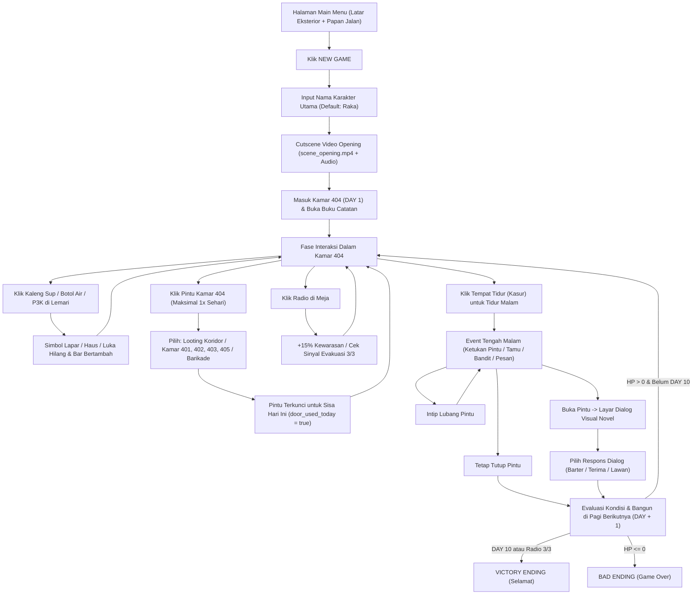

# LAPORAN PROPOSAL & PROGRESS PROJECT GAME
## "ROOM 404: APARTMENT LOCKDOWN SURVIVAL"

---

## COVER (Format Standar Laporan Itenas)

### LAPORAN PERANCANGAN & PENGEMBANGAN PROTOTYPE
# "ROOM 404: APARTMENT LOCKDOWN SURVIVAL"
#### GAME SIMULASI SURVIVAL & INTERACTIVE VISUAL NOVEL 2D BERBASIS GODOT ENGINE 4

 

*Diajukan untuk Memenuhi Tugas Mata Kuliah [Nama Mata Kuliah Anda]*  
*Semester [Ganjil/Genap] Tahun Akademik 2026 / 2027*

 

**[LOGO INSTITUT TEKNOLOGI NASIONAL (ITENAS) BANDUNG]**

 

**Disusun Oleh:**  
[Nama Lengkap Anda] — [NRP / NIM Anda]  
[Nama Anggota 2 (Jika Kelompok)] — [NRP]  
[Nama Anggota 3 (Jika Kelompok)] — [NRP]  

 

**PROGRAM STUDI [INFORMATIKA / DESAIN KOMUNIKASI VISUAL]**  
**FAKULTAS [TEKNOLOGI INDUSTRI / ARSITEKTUR DAN DESAIN]**  
**INSTITUT TEKNOLOGI NASIONAL**  
**BANDUNG**  
**2026**

---

## KATA PENGANTAR

Puji dan syukur penulis panjatkan ke hadirat Tuhan Yang Maha Esa karena atas rahmat dan karunia-Nya, penulis dapat menyelesaikan Laporan Proposal dan Progress Pengembangan Project Game yang berjudul **"ROOM 404: Apartment Lockdown Survival"** tepat pada waktunya.

Laporan ini disusun untuk mendokumentasikan tahapan perancangan konsep, analisis kebutuhan, *pretesting* alur interaksi, hingga pengembangan *prototype* permainan simulasi bertahan hidup (*survival simulation*) berbasis 2D menggunakan **Godot Engine 4**. Dalam proses penyusunan project dan laporan ini, penulis banyak mendapatkan bimbingan, masukan, serta dukungan dari berbagai pihak. Oleh karena itu, penulis mengucapkan terima kasih kepada:

1. Bapak/Ibu **[Nama Dosen Pengampu]**, selaku Dosen Pengampu mata kuliah yang telah memberikan arahan, evaluasi, serta masukan konstruktif terhadap pengembangan mekanika dan antarmuka game ini.
2. Rekan-rekan mahasiswa di **Institut Teknologi Nasional (Itenas) Bandung** yang telah membantu dalam tahap *brainstorming* dan pengujian awal (*pretesting*) *prototype* permainan.
3. Semua pihak yang tidak dapat disebutkan satu per satu atas dukungannya.

Penulis menyadari bahwa laporan dan *prototype* project ini masih memiliki ruang untuk pengembangan lebih lanjut. Oleh sebab itu, kritik dan saran yang membangun sangat penulis harapkan demi penyempurnaan karya ini di masa mendatang.

Bandung, November 2026  

**Penulis**

---

## DAFTAR ISI

- **COVER**
- **KATA PENGANTAR**
- **DAFTAR ISI**
- **BAB 1 – PENDAHULUAN**
  - a. Nama Project / Judul Project
  - b. Latar Belakang Project
- **BAB 2 – PERANCANGAN**
  - a. Pemilihan Ide (Riset, ATM, Brainstorming)
  - b. Analisis (Kebutuhan, Biaya dan Waktu, Isi Project, Target Usia dan Pasar, Media Teknologi dan Media Perantara)
  - c. Pretesting (Identifikasi Risiko, Model Alur Interaksi, dan Model Skenario)
  - d. Prototype Development (Contoh Aset yang Digunakan, Interface Antarmuka Project, dan Storyline)
- **BAB 3 – PENUTUP**
  - a. Kesimpulan
  - b. Saran

---

## BAB 1 – PENDAHULUAN

### a. Nama Project / Judul Project
- **Nama Project:** *ROOM 404: Apartment Lockdown Survival*
- **Genre:** *2D Point-and-Click Survival Simulation & Interactive Visual Novel*
- **Platform:** PC / Windows Desktop (Godot Engine 4) & Web HTML5 Prototype
- **Tema Utama:** Bertahan hidup di dalam kamar apartemen Lantai 4 (Unit 404) selama masa karantina darurat 10 hari dengan keterbatasan logistik, eksplorasi kamar tetangga, dan dilema moral.

### b. Latar Belakang Project
Perkembangan industri game independen (*indie game*) menunjukkan bahwa permainan dengan mekanika terfokus namun memiliki kedalaman narasi dan pengambilan keputusan (*decision-making*) mampu memberikan pengalaman bermain yang sangat kuat. Salah satu sub-genre yang diminati adalah *Single-Room Survival Simulation*, di mana pemain ditempatkan dalam ruang terbatas dengan sumber daya yang menipis dan harus bertahan hidup dari hari ke hari.

Di Indonesia, hunian vertikal seperti apartemen, rumah susun, maupun kos-kosan bertingkat merupakan latar tempat yang sangat dekat dengan keseharian mahasiswa dan masyarakat perkotaan. Namun, belum banyak game yang mengangkat ketegangan psikologis bertahan hidup di dalam satu unit kamar apartemen saat terjadi bencana isolasi/*lockdown* mendadak.

Project **"ROOM 404: Apartment Lockdown Survival"** berangkat dari gagasan tersebut. Angka **"404"** yang dalam dunia digital dikenal sebagai kode *"Not Found"* (Tidak Ditemukan) diadaptasikan menjadi nomor kamar apartemen di **Lantai 4 (Unit 404)** yang terputus dari bantuan luar. Pemain terbangun pada pukul **04:04 dini hari** akibat suara gemuruh hebat di luar gedung dan menerima peringatan darurat di *handphone* bahwa tidak boleh ada satu pun penghuni yang keluar gedung.

Melalui project ini, pemain ditantang untuk mengelola kebutuhan dasar (kesehatan, kewarasan, lapar, dan haus), berinteraksi langsung dengan objek di dalam kamar (lemari makanan/minuman, pintu kamar, radio darurat, buku catatan fisik, dan tempat tidur), serta menghadapi dilema moral ketika ada ketukan pintu di tengah malam.

---

## BAB 2 – PERANCANGAN

### a. Pemilihan Ide (Riset, ATM, Brainstorming)

#### 1. Riset (*Research*)
Penulis melakukan riset terhadap beberapa game *survival* dan *visual novel* populer:
- ***60 Seconds! Reatomized* (Robot Gentleman):** Menjadi referensi utama untuk gaya buku catatan harian fisik (*survival journal*), papan petunjuk jalan pada *Main Menu*, dan visualisasi stok kaleng sup serta botol air di rak penyimpanan.
- ***Quarantine / Freakshow Visual Novel* & *No, I'm Not a Human*:** Menjadi referensi utama untuk tampilan interaksi dialog tatap muka ketika tamu mengetuk pintu (karakter tamu berdiri besar di tengah layar, potret protagonis di kiri bawah, dan kotak dialog gelap bernuansa tegang).

#### 2. Metode ATM (Amati, Tiru, Modifikasi)
| Tahap ATM | Penjelasan Penerapan pada Project ROOM 404 |
| :--- | :--- |
| **Amati** | Mengamati cara *60 Seconds!* menyajikan buku catatan fisik (tidak transparan, memiliki gulungan halaman di kiri dan tab di kanan), halaman *Main Menu* bergaya papan penunjuk jalan di luar rumah, serta cara game *Visual Novel* menampilkan dialog tamu seperti petugas *Hazmat*. |
| **Tiru** | Mengadaptasi estetika buku catatan ber-tab untuk laporan harian, papan petunjuk jalan (*signpost*) untuk *Main Menu*, serta indikator kondisi karakter di sudut kiri atas layar. |
| **Modifikasi** | 1) Mengubah latar bunker nuklir 1950-an menjadi **Kamar 404 (Lantai 4 Apartemen)**. 2) Mengubah konsumsi pasif menjadi **interaksi klik langsung pada kaleng sup/botol air di lemari kamar** untuk menghilangkan simbol Lapar/Haus. 3) Menambahkan **Aturan Pintu 1x Sehari** (pilihan *Looting* dengan/tanpa senjata atau masuk ke **Kamar Tetangga 401, 402, 403, 405**). 4) Menggabungkan aksi **Klik Tempat Tidur** dengan **Event Ketukan Pintu Malam Hari** yang membuka layar obrolan *Visual Novel*. |

#### 3. Brainstorming & Evaluasi Desain
Dari proses *brainstorming* dan evaluasi pengembangan, ditetapkan **8 spesifikasi desain utama**:
1. Tampilan Buku Log dibuat tidak transparan (menyerupai buku catatan kertas fisik).
2. Informasi status menggunakan kombinasi **Simbol Dinamis** (`🍲 Lapar`, `💧 Haus`, `➕ Terluka`, `👁️ Cemas` yang langsung hilang saat pemain mengklik makanan/minuman/obat di lemari) serta **4 Bar Warna** (HP, Kewarasan, Lapar, Haus).
3. Karakter utama berjumlah **1 orang** dan **nama pemain dapat diketik/dipilih di awal menu game**.
4. Halaman *Main Menu* menggunakan latar eksterior gedung/jalanan yang berbeda dari dalam kamar, dilengkapi papan petunjuk menu.
5. Setiap hari pemain dapat mengklik langsung kaleng/botol di lemari, atau mengklik pintu (opsi *looting* dengan/tanpa senjata, atau menuju kamar tetangga 401/402/403/405).
6. Setelah pintu digunakan 1 kali pada hari tersebut, pintu terkunci dan pemain harus menggunakan objek lain (Radio, Makan/Minum, atau Tidur dengan mengklik Tempat Tidur).
7. Setiap tidur malam memicu *event* / *non-event* seperti ketukan pintu, pesan di bawah pintu, petugas *Hazmat*, tetangga, atau bandit.
8. Setiap *event* tamu memberikan opsi interaksi (**Buka Pintu**, **Intip Lubang Pintu**, atau **Tetap Tutup**) dan menampilkan obrolan bergaya *Visual Novel*.

---

### b. Analisis

#### 1. Analisis Kebutuhan
- **Perangkat Keras (*Hardware*):**
  - *Development PC:* Prosesor setara Intel Core i5 / AMD Ryzen 5, RAM 8 GB, GPU mendukung Vulkan / OpenGL 3.3.
  - *Target Device Pemain:* PC / Laptop spesifikasi ringan (RAM 4 GB, resolusi 1280x720).
- **Perangkat Lunak (*Software*):**
  - **Godot Engine v4.x** (Game Engine utama & GDScript)
  - **Visual Studio Code** (Code & JSON Editor)
  - **SVG Vector Graphics & AI Art/Video Tools** (Pembuatan aset 2D & video *opening*)
  - **Python OpenCV & Windows Media Foundation** (Ekstraksi *frame* HD dan audio stereo 48kHz dari `scene_opening.mp4`).

#### 2. Analisis Biaya dan Waktu
**Tabel Estimasi Biaya Pengembangan:**

| No | Komponen Kebutuhan | Lisensi / Sumber | Biaya |
| :-: | :--- | :--- | ---: |
| 1 | Godot Engine 4 | Open Source (MIT License) | Rp 0 |
| 2 | Visual Studio Code & Python Tools | Open Source / Freeware | Rp 0 |
| 3 | Pembuatan Aset Grafis SVG & Cutscene Video | In-House & Free AI Tier | Rp 0 |
| 4 | Listrik, Kuota Internet, & Operasional (4 Minggu) | Pribadi | Rp 150.000 |
| **Total** | | | **Rp 150.000** |

**Tabel Waktu / Jadwal Pengerjaan (4 Minggu):**

| Minggu | Tahapan Pengerjaan | Capaian (Deliverables) |
| :-: | :--- | :--- |
| **Minggu 1** | Riset, Brainstorming, & Storyline | Dokumen konsep cerita 10 hari, skenario event, dan video `scene_opening.mp4`. |
| **Minggu 2** | Pembuatan Prototype Awal | Prototype HTML5 & inisialisasi project Godot Engine 4 (`project.godot`). |
| **Minggu 3** | Evaluasi UI & Mekanika Kamar | Buku catatan fisik non-transparan, Main Menu eksterior, Simbol + 4 Bar, & klik objek kamar. |
| **Minggu 4** | Sistem Visual Novel & Finalisasi | Layar dialog VN (Hazmat, Tetangga, Bandit), sinkronisasi audio video, & laporan. |

#### 3. Analisis Isi Project
Project ini berisi simulasi bertahan hidup selama **10 hari** di dalam Kamar 404 dengan dua jalur kemenangan (*Victory Conditions*):
1. **True Good Ending:** Bertahan hidup menjaga HP dan kewarasan hingga **DAY 10** saat helikopter evakuasi tiba di atap gedung.
2. **Secret Radio Ending:** Mengumpulkan **3/3 Komponen Radio Darurat** (dari *looting* koridor atau barter dengan tetangga/petugas *Hazmat*) lalu menyalakan Radio di meja kamar untuk memanggil evakuasi lebih cepat.

#### 4. Analisis Target Usia dan Pasar
- **Target Usia:** Remaja hingga Dewasa Muda (**13+ / Teen**, rentang usia 15–28 tahun).
- **Target Pasar:** Pelajar, mahasiswa, dan penggemar game *indie survival-simulation* serta *interactive visual novel* di platform PC/Desktop yang menyukai permainan berbasis strategi manajemen sumber daya dan percabangan cerita.

#### 5. Analisis Media Teknologi dan Media Perantara
- **Media Teknologi:** Menggunakan **Godot Engine 4** dengan arsitektur *Autoload Singleton* (`GameState.gd`) dan *Scene Controller* (`MainRoom404.gd`), aset grafik berbasis vektor (`.svg`) yang tajam di segala ukuran layar, serta pemutar *cutscene* tersinkronisasi (`scene_opening.mp4` + `scene_opening_audio.wav`).
- **Media Perantara:** File *executable* desktop Windows (`.exe`) / project Godot yang dapat dijalankan secara lokal maupun didistribusikan melalui platform *indie* seperti *itch.io*.

---

### c. Pretesting

#### 1. Identifikasi Risiko dan Mitigasi
| No | Identifikasi Risiko | Dampak | Solusi / Mitigasi yang Diterapkan |
| :-: | :--- | :--- | :--- |
| 1 | `VideoStreamPlayer` Godot 4 tidak membaca `.mp4` secara langsung & tanpa suara | Video pembuka tidak tampil atau bisu saat dijalankan | Mengekstrak 300 *frame* HD (`1280x720`) dan audio stereo 48kHz (`scene_opening_audio.wav`) serta menyinkronkan *frame* dengan waktu audio. |
| 2 | Pemain mengeksploitasi klik Pintu berkali-kali dalam satu hari | Stok makanan tidak terbatas (*infinite farming*) | Menerapkan pengunci `door_used_today = true` setelah 1x pemakaian per hari; pintu baru terbuka kembali keesokan paginya. |
| 3 | Tampilan buku log transparan sulit dibaca | Teks bertabrakan dengan objek latar kamar | Merancang aset `notebook_60s.svg` berlatar kertas padat (*non-transparent*) dengan 4 tab halaman. |

#### 2. Model Alur Interaksi (*Interaction Flowchart*)

#### 3. Model Skenario
1. **Skenario Eksplorasi Kamar Tetangga Lantai 4:**
   - **Kamar 401:** Berisi stok logistik peninggalan penghuni lama (+1 Sup, +1 Air) atau ruangan kosong yang mengurangi kewarasan.
   - **Kamar 402 (Kamar Siska):** Memicu adegan *Visual Novel* bersama Siska (opsi barter 1 Air dengan 2 Sup, minta pengobatan medis +30% HP, atau berdiskusi).
   - **Kamar 403 (Koridor Gelap):** Berisi penjarah/jebakan. Jika pemain mengaktifkan opsi **"Bawa Senjata Pipa Besi"**, penjarah kabur meninggalkan +1 Kotak P3K; jika tangan kosong, pemain terluka (-22% HP).
   - **Kamar 405 (Zona Karantina):** Memicu adegan *Visual Novel* bersama Petugas *Hazmat* yang memberikan logistik *404 Mart* atau komponen radio.
2. **Skenario Tamu Tengah Malam (Saat Tidur):**
   - Ketukan Petugas *Hazmat* (bantuan logistik/barter P3K).
   - Ketukan Tetangga Kamar 402 (barter 1 Kaleng Sup dengan +1 Komponen Radio).
   - Gedoran Bandit Koridor (ancaman penjarahan; aman jika pintu tetap ditutup atau dilawan dengan senjata).
   - Amplop pesan darurat yang diselipkan di bawah celah pintu.

---

### d. Prototype Development

#### 1. Contoh Aset yang Digunakan
Berikut daftar aset utama yang dikembangkan dan digunakan di dalam `godot_project/`:

| Kategori Aset | File Aset (`godot_project/assets/`) | Deskripsi Visual |
| :--- | :--- | :--- |
| **Background Menu** | `backgrounds/bg_main_menu.svg` | Ilustrasi eksterior jalanan & Gedung 404, mobil biru klasik, sepeda merah, dan tiang papan jalan. |
| **Background Kamar** | `backgrounds/bg_room404.svg` | Ilustrasi interior Kamar 404 meliputi Pintu Berbarikade, Lemari Logistik, Jendela & Meja Radio, serta Tempat Tidur. |
| **Buku Catatan** | `props/notebook_60s.svg` | Ilustrasi buku catatan fisik *non-transparan* dengan gulungan halaman kiri, pita merah, dan 4 tab kanan. |
| **Karakter & Potret** | `characters/char_raka.svg`, `player_portrait.svg` | Sprite karakter utama bernapas di kamar & potret wajah di sudut kiri bawah layar *Visual Novel*. |
| **Karakter Tamu VN** | `characters/npc_hazmat.svg`, `npc_neighbor.svg`, `npc_bandit.svg` | Ilustrasi karakter tamu berukuran besar untuk layar obrolan *Visual Novel*. |
| **Objek Lemari** | `props/soup.svg`, `water.svg`, `medkit.svg` | Objek Kaleng Sup, Botol Air, dan Kotak P3K yang tampil dinamis sesuai jumlah stok. |
| **Cutscene Pembuka** | `video/scene_opening.mp4` & `scene_opening_audio.wav` | Video pembuka berdurasi 20 detik (1920x1080) beserta audio stereo 48.000 Hz. |

#### 2. Interface / Antarmuka Project
1. **Main Menu Signpost UI:** Terletak di sisi kiri layar dengan papan bertuliskan `NEW GAME`, `Options`, `Credits`, dan `Exit`, serta popup pengisian nama karakter utama.
2. **In-Game HUD (Simbol + Bar Warna):**
   - Sudut kiri atas menampilkan simbol aktif (`➕ TERLUKA`, `🍲 LAPAR`, `💧 HAUS`, `👁️ CEMAS`) yang langsung hilang saat pemain mengklik makanan/minuman/obat di lemari.
   - Bagian tengah atas menampilkan 4 *ProgressBar* berwarna (`❤️ HP`, `🧠 WARAS`, `🍲 LAPAR`, `💧 HAUS`).
   - Sudut kanan atas menampilkan indikator hari (`DAY 1`) dan tombol `MENU`.
3. **Buku Catatan 60 Seconds! UI:** Menampilkan teks laporan di atas kertas coklat padat dengan 4 tab navigasi (`DAY`, `LOGISTIK`, `LANTAI 4`, `EVAKUASI`).
4. **Visual Novel Dialogue UI:** Menampilkan lawan bicara di tengah layar, potret pemain di kiri bawah, kotak teks hitam dengan aksen bercak merah, serta 3 tombol pilihan respons dialog.

#### 3. Storyline
- **Prolog (Pukul 04:04 WIB):** Sehari sebelumnya kehidupan di apartemen berjalan normal. Keesokan paginya pukul 04:04 dini hari, tokoh utama terbangun di lantai Kamar 404 karena suara gemuruh hebat dari luar gedung. Notifikasi darurat di *handphone* memerintahkan seluruh penghuni untuk mengunci pintu dan tidak keluar kamar sampai informasi evakuasi selanjutnya.
- **Perkembangan Konflik (Hari 1 – Hari 10):** Dengan persediaan awal hanya 3 Kaleng Sup, 3 Botol Air, 1 P3K, 1 Pipa Besi, dan 1/3 Komponen Radio, pemain harus mengatur strategi harian antara bertahan di dalam kamar, memeriksa kamar tetangga di Lantai 4 maksimal satu kali sehari, serta menghadapi tamu misterius yang mengetuk pintu setiap malam.

---

## BAB 3 – PENUTUP

### a. Kesimpulan
1. Project game **"ROOM 404: Apartment Lockdown Survival"** telah berhasil dirancang dan dikembangkan menjadi *prototype* interaktif berbasis **Godot Engine 4** yang menggabungkan mekanika *Point-and-Click Room Survival* dengan *Interactive Visual Novel*.
2. Seluruh 8 poin evaluasi perancangan—mulai dari buku catatan *non-transparan*, indikator simbol kebutuhan yang hilang saat mengklik makanan/minuman di lemari + 4 bar warna, kustomisasi nama karakter tunggal, *Main Menu* bergaya papan petunjuk jalan dengan latar berbeda, aturan penggunaan pintu maksimal 1 kali sehari beserta pilihan 4 kamar tetangga, hingga interaksi tidur malam dan layar dialog *Visual Novel*—telah berfungsi dengan baik.

### b. Saran
1. Menambahkan efek suara (*Sound Effects*) interaktif pada setiap klik objek di kamar (suara membuka kaleng sup, meneguk air, ketukan pintu kayu, dan langkah kaki di koridor).
2. Memperluas jumlah *event* acak dan menambahkan sistem penyimpanan (*Save/Load Game*) serta galeri pencapaian (*Achievements & Memories*) pada halaman *Main Menu*.
